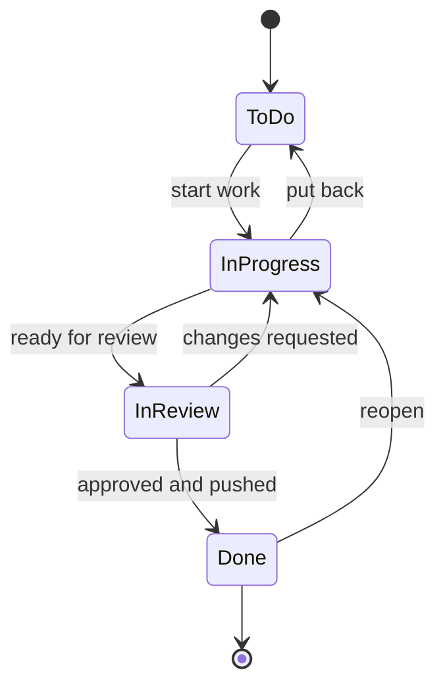

# Jira Scrum Plan: First Three Weeks

How the SmartMart team runs its first three weeks in Jira using Scrum. It covers the Jira space setup, the issue workflow, the ceremonies, and the backlog for three one-week sprints.

The sprints, epics and issues already exist in the **Team Astro** space on [smartmart.atlassian.net](https://smartmart.atlassian.net/jira/software/projects/SCRUM/boards/1/backlog) (key `SCRUM`). The same backlog is in [jira-backlog.csv](jira-backlog.csv) as a record and for re-importing into another space.

The plan follows the rules already in the repository: the increment order in GUIDELINES.md section 1 (user management as the foundation, then POS), the stack and architecture in GUIDELINES.md, and the commit rules in COMMIT.md.

## Assumptions

Change these before importing if they are wrong.

| # | Assumption |
| --- | --- |
| A1 | "Three weeks" means **three one-week sprints**, the first three weeks of the 10-week project. Longer sprints would leave only one or two demos in the window, and GUIDELINES.md asks for a demo at the end of every sprint. |
| A2 | Sprints run **Sunday to Saturday** (Bangladesh week). Sprint 1 starts on **Sun 1 Nov 2026**. Ceremonies are on class days; Friday and Saturday are buffer. |
| A3 | Three team members, each giving about 8 to 10 focused hours per sprint. Planned capacity is **about 24 story points per sprint**. Re-estimate after Sprint 1 from the real velocity. |
| A4 | Product Owner and Scrum Master are rotated among the three members, one sprint each. |
| A5 | Jira Cloud, **Scrum** template, **team-managed** space (Team Astro). Team-managed spaces cannot enforce every workflow condition below, so the ones Jira cannot enforce are team rules. |

## 1. Jira space setup

| Setting | Value |
| --- | --- |
| Site | `smartmart.atlassian.net` |
| Space | Team Astro, team-managed |
| Space key | `SCRUM` (issues are `SCRUM-1`, `SCRUM-2`, ...) |
| Template | Scrum, board "SCRUM board" |
| Issue types | Epic, Story, Task, Subtask. The space has no Bug type yet; add one in Space settings → Work types, or use a Task labelled `bug`. |
| Estimation | Story point estimate (Fibonacci: 1, 2, 3, 5, 8). Anything above 8 is split before it enters a sprint. |
| Priorities | Highest, High, Medium, Low |
| Scope labels | `pos`, `inventory`, `purchasing`, `auth`, `reports`, `db`, `ui`, `api`, `srs`, `uml`, `plan`, `repo` (the scopes from COMMIT.md, so a Jira label matches a commit scope). Team-managed spaces have no components, so labels do this job. Issues also carry topic labels such as `security`, `pattern` or `docs`. |

### Issue types

| Type | Use it for | Example |
| --- | --- | --- |
| Epic | One module or one stream of course documents | "Point of sale" |
| Story | A user-visible capability, written as "As a role, I can ..." | "As a cashier, I can add items to a cart by barcode" |
| Task | Technical or documentation work with no direct user value | "Draw the use case diagram" |
| Bug (not in the space yet) | A defect in something already marked Done | "Low-stock alert fires at zero threshold" |
| Subtask | A slice of a story that one person can finish in a day | "Write basis path tests for checkout" |

### Epics

| Key | Epic | Covers | In these three weeks |
| --- | --- | --- | --- |
| SCRUM-5 | Foundation | Spring Boot skeleton, Docker Compose, CI, primary/replica routing, Liquibase, error handling | Sprint 1 |
| SCRUM-6 | User management | Login, roles, RBAC, user administration | Sprints 1 and 2 |
| SCRUM-7 | Inventory | Categories, products, stock batches (later: alerts, expiry) | Sprint 2 (the part POS needs) |
| SCRUM-8 | Point of sale | Cart, discounts, checkout, payment, invoice | Sprint 3 |
| SCRUM-9 | Purchasing | Suppliers, purchase orders, receiving, returns | Later sprints |
| SCRUM-10 | Reporting | Reports and dashboard | Later sprints |
| SCRUM-11 | Course documents | SRS, UML, estimation, risk register, test document | Every sprint |

## 2. Workflow

Four statuses, one board column each. "Blocked" is a **flag** on the issue, not a status, so a blocked issue stays in the column where it stopped.



| Status | Meaning | Entry rule (condition or team rule) |
| --- | --- | --- |
| **To Do** | In the sprint, not started | Meets the Definition of Ready |
| **In Progress** | Someone is working on it | Assignee is set (the automation rule below fills it in). WIP limit: **3**, one issue per person. |
| **In Review** | Work is complete on the author's machine; a teammate checks it | `./mvnw verify` passes locally (once the build exists). Author has run the GUIDELINES.md section 12 checklist. Reviewer is not the assignee. WIP limit: **2**. |
| **Done** | Meets the Definition of Done | Reviewer approved, commit pushed to `main`, CI is green, every acceptance criterion is met |

**How review works without branches.** `main` is the only branch and pull requests are not used (CLAUDE.md section 0). Review therefore happens **before the push**: the author shares the diff (`git diff` or `git format-patch`, or a short screen share), the reviewer checks it against GUIDELINES.md section 12 and the issue's acceptance criteria, and only then does the author push. Changes found later go in as new commits, never by rewriting `main`.

**Reopening.** If a Done issue turns out to be wrong in the same sprint, move it back to In Progress. If it is found after the sprint ends, raise a Bug instead.

### Definition of Ready

An issue can enter a sprint only when:

- [ ] It has a clear title and is linked to an epic.
- [ ] It has acceptance criteria that can be checked (CLAUDE.md section 4: "a test proves it", not "make it work").
- [ ] It is estimated at 8 points or fewer.
- [ ] Open questions (for example "percentage or flat discount?") are answered in the SRS or `docs/decisions.md`.
- [ ] Its dependencies are Done or in the same sprint and planned earlier.

### Definition of Done

An issue is Done only when:

- [ ] Every acceptance criterion is met and was checked.
- [ ] Unit and integration tests are added and pass; basis path tests exist for the critical methods in GUIDELINES.md section 9.
- [ ] The change passes the GUIDELINES.md section 12 review checklist, and a teammate reviewed it.
- [ ] Diagrams in `docs/uml/` are updated for what changed (GUIDELINES.md section 10).
- [ ] The commit follows COMMIT.md and its footer names the issue, for example `Refs: SCRUM-14`.
- [ ] The commit is on `main` and CI is green.

### Linking commits to Jira

Install the **GitHub for Jira** app and connect the repository. Jira then shows each commit on the issue whose key appears in the commit message. Put the key in a footer, so the header stays within 72 characters:

```
feat(pos): add barcode lookup to cart

Unknown barcodes show an error instead of adding an empty line.

Refs: SCRUM-28
```

Note: COMMIT.md currently says to reference **GitHub issues** in footers, and the README says to use GitHub issues for problems and scope changes. If the team adopts Jira, update both in a `docs(repo)` commit so there is one tracker.

### Board settings and automation (not set up yet)

Set WIP limits in **Board → View settings** (or Board settings → Columns): In Progress 3, In Review 2.

Automation rules (Space settings → Automation):

| Trigger | Action |
| --- | --- |
| Issue moved to In Progress, no assignee | Assign to the person who moved it |
| All sub-tasks of an issue are Done | Comment on the parent: "All sub-tasks done, ready for review" |
| Issue flagged | Comment that tags the Scrum Master |
| Sprint started | Post the sprint goal to the team channel, if one is connected |

## 3. Ceremonies

| Ceremony | When | Length | Output |
| --- | --- | --- | --- |
| Sprint planning | Sunday, first day of the sprint | 45 min | Sprint goal; issues moved from the backlog into the sprint; sub-tasks and owners |
| Daily stand-up | Each class day (Sun to Thu), in person or as a thread | 10 min | Yesterday, today, blockers. Blocked issues are flagged in Jira. |
| Backlog refinement | Tuesday | 30 min | Next sprint's issues meet the Definition of Ready and are estimated |
| Sprint review (demo) | Thursday | 30 min | Working demo of the sprint goal, updated diagrams, passing tests (GUIDELINES.md section 1) |
| Retrospective | Thursday, after the review | 20 min | One or two actions for the next sprint, added as Tasks |

Board reports to check: **Burndown** during the sprint, **Velocity** at each review, **Sprint report** at each retrospective.

## 4. Sprint plan

| Sprint | Dates | Goal | Points |
| --- | --- | --- | --- |
| SM Sprint 1 | Sun 1 Nov to Sat 7 Nov 2026 | A running skeleton on two databases, an admin can log in, and the requirements for Auth, Inventory and POS are agreed | 23 |
| SM Sprint 2 | Sun 8 Nov to Sat 14 Nov 2026 | Access is restricted by role, and inventory staff can maintain the product catalogue and stock that POS sells from | 24 |
| SM Sprint 3 | Sun 15 Nov to Sat 21 Nov 2026 | A cashier completes a cash sale end to end: barcode, cart, discount, payment, invoice, and stock goes down | 23 |

The order follows the dependencies: POS cannot sell without products and stock, and every module needs login and roles. This matches GUIDELINES.md section 1, which builds user management in the first increment.

### Team and work split

| Member | Jira name | Area | Gets |
| --- | --- | --- | --- |
| Prottoy | MD. SHAHRIAR HOSSAIN PROTTOY | Backend | Backend stories and tasks (about 10 to 11 points per sprint), SRS v1 |
| Jani | Rafsan Jani | Backend | Backend stories and tasks (about 11 points per sprint), class diagram and ERD |
| Emon | MD. SHAHARIAR EMON SAIKAT | Frontend | One frontend subtask under each story that has screens, plus one diagram or plan task per sprint |

The backend owner of a story owns its service, repository, REST endpoint and tests. The Thymeleaf pages for that story are a **frontend subtask** assigned to Emon, so a story is Done only when both parts are. Backend owners agree the controller's model attributes or JSON shape with Emon at the start of the story.

The split by module keeps each backend person in one area per sprint where possible: Jani takes the foundation plumbing, auth and checkout; Prottoy takes the replica routing, the catalogue and the cart. Subtasks have no story points, so sprint totals stay as planned. Product backlog stories have provisional owners; confirm them, and add Emon's frontend subtasks, when each story enters a sprint.

| Subtask | Parent | Sprint | Frontend work |
| --- | --- | --- | --- |
| SCRUM-38 | SCRUM-17 | 1 | Shared Thymeleaf layout, login and logout pages |
| SCRUM-39 | SCRUM-20 | 2 | Menu items hidden by role, 401 and 403 pages |
| SCRUM-40 | SCRUM-21 | 2 | User list, user form, role assignment |
| SCRUM-41 | SCRUM-23 | 2 | Category tree page |
| SCRUM-42 | SCRUM-24 | 2 | Product list and product form |
| SCRUM-43 | SCRUM-25 | 2 | Stock batch form, stock on the product page |
| SCRUM-44 | SCRUM-28 | 3 | POS cart screen with barcode input and undo |
| SCRUM-45 | SCRUM-30 | 3 | Discount selection on the cart screen |
| SCRUM-46 | SCRUM-31 | 3 | Cash payment step |
| SCRUM-47 | SCRUM-32 | 3 | Invoice page |

### Sprint 1: Foundation and requirements

| Key | Type | Summary | Epic | SP | Owner |
| --- | --- | --- | --- | --- | --- |
| SCRUM-12 | Task | Generate the Spring Boot 3 project with the Maven wrapper | Foundation | 2 | Prottoy |
| SCRUM-13 | Task | Add a CI workflow that runs the Maven build and tests | Foundation | 1 | Jani |
| SCRUM-14 | Task | Add the application service and Dockerfile to Docker Compose | Foundation | 2 | Jani |
| SCRUM-15 | Story | Route read-only transactions to the replica | Foundation | 5 | Prottoy |
| SCRUM-16 | Task | Add the Liquibase baseline and the global error handler | Foundation | 3 | Jani |
| SCRUM-17 | Story | As a user, I can log in with my username and password | User management | 5 | Jani |
| SCRUM-18 | Task | Write SRS v1 for Auth, Inventory and POS | Course documents | 3 | Prottoy |
| SCRUM-19 | Task | Draw the use case diagram | Course documents | 2 | Emon |

Demo: `docker compose up` starts the app and both databases; the seeded admin logs in; a test shows a read-only query hitting the replica.

### Sprint 2: Roles and catalogue

| Key | Type | Summary | Epic | SP | Owner |
| --- | --- | --- | --- | --- | --- |
| SCRUM-20 | Story | Restrict every page and endpoint by role, default deny | User management | 3 | Jani |
| SCRUM-21 | Story | As an admin, I can create, edit and deactivate users and assign roles | User management | 5 | Jani |
| SCRUM-23 | Story | As inventory staff, I can manage a category tree | Inventory | 3 | Prottoy |
| SCRUM-24 | Story | As inventory staff, I can add and edit products with a unique barcode | Inventory | 5 | Prottoy |
| SCRUM-25 | Story | As inventory staff, I can record stock batches with an expiry date | Inventory | 3 | Prottoy |
| SCRUM-26 | Task | Draw the class diagram and ERD v1 | Course documents | 3 | Jani |
| SCRUM-27 | Task | Write the WBS, estimate, Gantt chart and risk register | Course documents | 2 | Emon |

Demo: an admin creates a cashier and an inventory user; the cashier is refused the product pages (403); inventory staff add a category, a product and a stock batch.

### Sprint 3: First sale

| Key | Type | Summary | Epic | SP | Owner |
| --- | --- | --- | --- | --- | --- |
| SCRUM-28 | Story | As a cashier, I can add items to a cart by barcode and change quantities | Point of sale | 5 | Prottoy |
| SCRUM-29 | Story | As a cashier, I can undo the last cart change | Point of sale | 2 | Prottoy |
| SCRUM-30 | Story | As a cashier, I can apply a percentage or flat discount | Point of sale | 3 | Jani |
| SCRUM-31 | Story | As a cashier, I can complete a cash sale that deducts stock first-expiry-first-out | Point of sale | 8 | Jani |
| SCRUM-32 | Story | As a cashier, I can see the invoice straight after a sale | Point of sale | 3 | Prottoy |
| SCRUM-33 | Task | Draw the checkout sequence and activity diagrams | Course documents | 2 | Emon |

Demo: scan two products, undo one change, apply a 10% discount, pay cash, show the invoice, and show the stock batch quantities going down in expiry order.

### Product backlog after week 3 (not in a sprint yet)

| Key | Type | Summary | Epic | Provisional owner |
| --- | --- | --- | --- | --- |
| SCRUM-22 | Story | Lock out repeated failed logins (rate limit) | User management | Jani |
| SCRUM-34 | Story | Low-stock and near-expiry alerts | Inventory | Prottoy |
| SCRUM-35 | Story | Supplier management | Purchasing | Prottoy |
| SCRUM-36 | Story | Purchase orders with state transitions | Purchasing | Jani |
| SCRUM-37 | Story | Daily sales report | Reporting | Jani |

SCRUM-22 is the first candidate for Sprint 4: it was cut from Sprint 2 to stay within capacity, and it is a GUIDELINES.md section 7 requirement, not a stretch goal.

Acceptance criteria for every issue are in its Jira description, and in the Description column of [jira-backlog.csv](jira-backlog.csv).

## 5. State of the Jira space

Created on 1 Nov 2026 in Team Astro (`SCRUM`):

- Sprints **SM Sprint 1**, **SM Sprint 2** and **SM Sprint 3**, with the dates and goals from section 4. None is started.
- Epics SCRUM-5 to SCRUM-11 and issues SCRUM-12 to SCRUM-37, with description, priority, story point estimate, labels and parent epic. Issues without a sprint are in the backlog.
- Sprint issues assigned and frontend subtasks SCRUM-38 to SCRUM-47 added for Emon, as in section 4.
- The space's earlier items (SCRUM Sprint 0, SCRUM Sprint 1, and SCRUM-1 to SCRUM-4) were left as they were.

To start the plan:

1. Complete **SCRUM Sprint 0**, which is still active. Jira can only run one sprint at a time unless parallel sprints are turned on.
2. Set the WIP limits and automation rules from section 2.
3. Start **SM Sprint 1** with its goal from section 4.

### Re-importing into another space

To load the same backlog into a different space, use **Filters → Import issues** (or Settings → System → External system import → CSV) with `docs/plan/jira-backlog.csv`. Create the three sprints first, with the exact names above. Map each column to the Jira field of the same name, except Story Points → "Story point estimate" in a team-managed space, and Component → "Component/s" in a company-managed space (a team-managed space has no components; map it to Labels). Issue Id and Parent Id only link stories to their epics during the import; Jira assigns the real keys.
