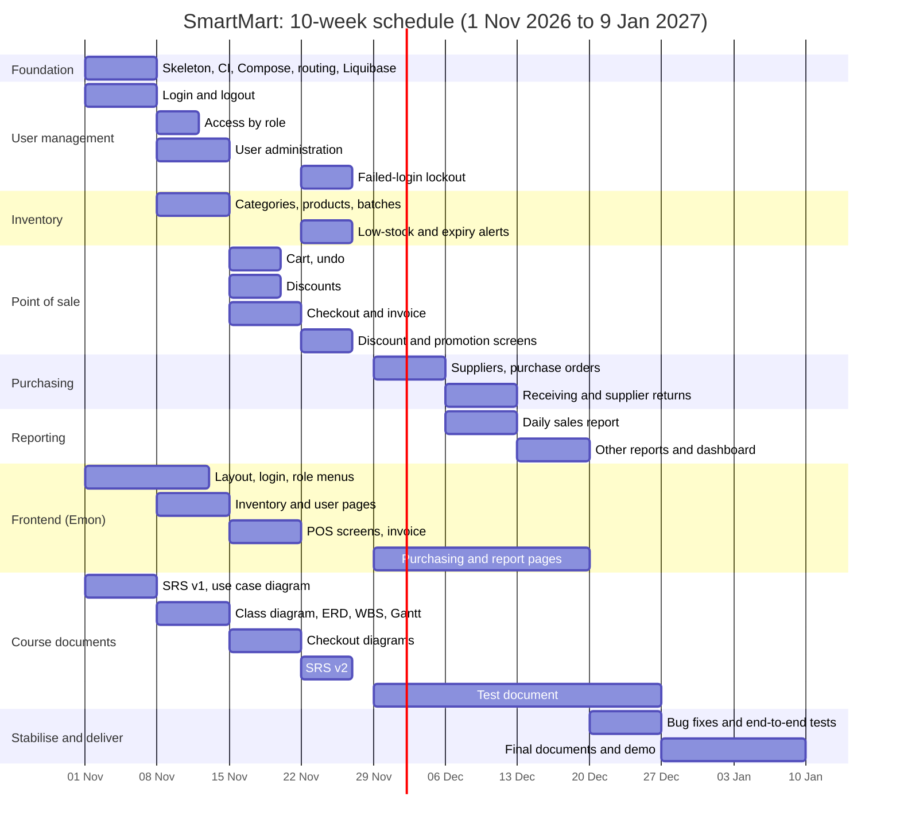

# SmartMart: WBS, Estimate, Schedule and Risk Register

Planning documents for the full 10-week project (Jira SCRUM-27). Weeks 1 to 3 come from [jira-scrum-plan.md](jira-scrum-plan.md). **Weeks 4 to 10 are a proposal**: the repository does not plan them yet, so the team should confirm or change them at refinement.

## Assumptions

| # | Assumption |
| --- | --- |
| P1 | The project has **10 one-week sprints**, Sunday to Saturday. Week 1 starts on Sun 1 Nov 2026, so week 10 ends on Sat 9 Jan 2027 (jira-scrum-plan.md A1, A2). |
| P2 | Planned capacity is **about 24 story points per sprint** (jira-scrum-plan.md A3). It is re-estimated after each sprint from the real velocity. |
| P3 | Sprint 1 to 3 points (23, 24, 23 = 70) are taken from the plan. Points for later items are **proposed** and marked so. |
| P4 | Frontend subtasks (SCRUM-38 to SCRUM-47) carry no points in Jira, so they are not counted in the totals below. Diagram and plan tasks carry points. |
| P5 | The scope is the five modules in the README, in priority order. Stretch goals are excluded from the schedule and start only if all five modules work. |
| P6 | The last sprint is kept free of new features, for testing, the final documents and the demo. |

## 1. Work breakdown structure (WBS)

```text
1   SmartMart
├── 1.1 Foundation                              (epic SCRUM-5)
│   ├── 1.1.1 Spring Boot skeleton, Maven wrapper         SCRUM-12
│   ├── 1.1.2 CI workflow                                 SCRUM-13
│   ├── 1.1.3 Application in Docker Compose               SCRUM-14
│   ├── 1.1.4 Primary/replica routing                     SCRUM-15
│   └── 1.1.5 Liquibase baseline, global error handler    SCRUM-16
├── 1.2 User management                         (epic SCRUM-6)
│   ├── 1.2.1 Login and logout                            SCRUM-17 (+ UI SCRUM-38)
│   ├── 1.2.2 Access by role, default deny                SCRUM-20 (+ UI SCRUM-39)
│   ├── 1.2.3 User administration                         SCRUM-21 (+ UI SCRUM-40)
│   └── 1.2.4 Failed-login lockout                        SCRUM-22
├── 1.3 Inventory                               (epic SCRUM-7)
│   ├── 1.3.1 Category tree                               SCRUM-23 (+ UI SCRUM-41)
│   ├── 1.3.2 Products                                    SCRUM-24 (+ UI SCRUM-42)
│   ├── 1.3.3 Stock batches                               SCRUM-25 (+ UI SCRUM-43)
│   └── 1.3.4 Low-stock and near-expiry alerts            SCRUM-34
├── 1.4 Point of sale                           (epic SCRUM-8)
│   ├── 1.4.1 Cart by barcode                             SCRUM-28 (+ UI SCRUM-44)
│   ├── 1.4.2 Undo                                        SCRUM-29
│   ├── 1.4.3 Discounts                                   SCRUM-30 (+ UI SCRUM-45)
│   ├── 1.4.4 Checkout, cash, FEFO stock deduction        SCRUM-31 (+ UI SCRUM-46)
│   ├── 1.4.5 Invoice                                     SCRUM-32 (+ UI SCRUM-47)
│   └── 1.4.6 Manager screens for discounts/promotions    not yet in Jira (SRS Q1)
├── 1.5 Purchasing                              (epic SCRUM-9)
│   ├── 1.5.1 Suppliers                                   SCRUM-35
│   ├── 1.5.2 Purchase orders with state transitions      SCRUM-36
│   └── 1.5.3 Receiving and supplier returns              proposed
├── 1.6 Reporting                               (epic SCRUM-10)
│   ├── 1.6.1 Daily sales report                          SCRUM-37
│   ├── 1.6.2 Purchase, inventory and profit reports      proposed
│   └── 1.6.3 Dashboard                                   proposed
└── 1.7 Course documents                        (epic SCRUM-11)
    ├── 1.7.1 SRS v1 (Auth, Inventory, POS)               SCRUM-18
    ├── 1.7.2 Use case diagram                            SCRUM-19
    ├── 1.7.3 Class diagram and ERD                       SCRUM-26
    ├── 1.7.4 WBS, estimate, Gantt, risk register         SCRUM-27 (this file)
    ├── 1.7.5 Checkout sequence and activity diagrams     SCRUM-33
    ├── 1.7.6 SRS v2 (Purchasing, Reporting)              proposed
    ├── 1.7.7 Test document (basis path tests)            proposed
    └── 1.7.8 Deployment diagram, final report, demo      proposed
```

## 2. Estimate

Method: bottom-up. Each story is sized in Fibonacci story points (1, 2, 3, 5, 8) and the total is divided by the planned velocity. Anything above 8 is split before it enters a sprint.

| Sprint | Weeks | Dates | Points | Basis |
| --- | --- | --- | --- | --- |
| 1 | 1 | 1 to 7 Nov | 23 | jira-scrum-plan.md |
| 2 | 2 | 8 to 14 Nov | 24 | jira-scrum-plan.md |
| 3 | 3 | 15 to 21 Nov | 23 | jira-scrum-plan.md |
| 4 | 4 | 22 to 28 Nov | 21 | proposed |
| 5 | 5 | 29 Nov to 5 Dec | 22 | proposed |
| 6 | 6 | 6 to 12 Dec | 22 | proposed |
| 7 | 7 | 13 to 19 Dec | 21 | proposed |
| 8 | 8 | 20 to 26 Dec | 18 | proposed |
| 9 | 9 | 27 Dec to 2 Jan | 14 | proposed (stabilise) |
| 10 | 10 | 3 to 9 Jan | 8 | proposed (documents and demo) |
| | | **Total** | **196** | 70 planned + 126 proposed |

Capacity check: 10 sprints × 24 points = 240 points of capacity against 196 planned, so about 44 points (18 %) are held back as buffer for rework, the frontend subtasks that carry no points, and slow weeks.

### Proposed items after week 3 (points to be confirmed at refinement)

| Sprint | Items | Points |
| --- | --- | --- |
| 4 | SCRUM-22 failed-login lockout (3); SCRUM-34 low-stock and near-expiry alerts (5); manager screens for discounts and promotions (5); SRS v2 for Purchasing and Reporting (3); class diagram update (2); risk review (1); PO state diagram (2) | 21 |
| 5 | SCRUM-35 suppliers (3); SCRUM-36 purchase orders with state transitions (8); UI for suppliers and purchase orders (no points); test document draft (3); basis path tests for discount and stock deduction (5); diagram updates (3) | 22 |
| 6 | Receiving goods into stock batches (5); supplier returns (5); SCRUM-37 daily sales report (5); report factory (3); diagram updates (2); UI for receiving and returns (no points); test document (2) | 22 |
| 7 | Purchase, inventory and profit reports (8); dashboard (5); report UI (no points); basis path tests for PO receiving (3); diagram updates (2); integration tests (3) | 21 |
| 8 | Bug fixes from demos (5); role and permission review (3); end-to-end test pass (5); performance check against NFR-2 (3); deployment diagram (2) | 18 |
| 9 | Test document final (4); release notes and run guide (3); fixes (5); final class diagram and ERD (2) | 14 |
| 10 | Final report (3); demo rehearsal and demo (3); last fixes and tag (2) | 8 |

## 3. Schedule (Gantt chart)

Dates are Sunday to Saturday. Diagram and plan tasks run alongside the code, as GUIDELINES.md section 10 asks. The chart renders on GitHub.



## 4. Risk register

Probability (P) and impact (I) use a 1 to 3 scale: 1 low, 2 medium, 3 high. Score = P × I. A score of 6 or more needs an active mitigation; review the register at every sprint retrospective.

| ID | Risk | P | I | Score | Mitigation | Owner |
| --- | --- | --- | --- | --- | --- | --- |
| R1 | A backend story is late, so its frontend subtask cannot start (every UI subtask waits for a backend one) | 3 | 2 | 6 | Backend owners publish the controller model attributes and field names on day 1 of each story. Emon builds a static mock first and wires it up later. Flag blocked issues at stand-up. | Prottoy, Jani |
| R2 | Only three people and about 8 to 10 focused hours each per week, with other courses and exams competing | 3 | 3 | 9 | Keep sprint load at or below the measured velocity. Cut stretch goals first. Keep week 8 to 10 free of new features. Re-plan at each retrospective. | All |
| R3 | Checkout (SCRUM-31, 8 points) is the largest item and touches cart, discount, payment, stock and invoice | 2 | 3 | 6 | Agree the cart API before Jani starts. Keep checkout behind the `CheckoutFacade`. Write basis path tests as the method is written. Split if it passes 8 points. | Jani |
| R4 | Replication lag makes a read-only page show stale data, or a read that must be current goes to the replica | 2 | 2 | 4 | Reads that must see a just-made write (login, invoice, checkout) are not `readOnly` (GUIDELINES.md 8.2, NFR-5). Integration test with `pg_is_in_recovery()`. | Prottoy |
| R5 | Two database servers make local setup harder, and the integration tests fail when Docker is not running | 2 | 2 | 4 | `docker compose up -d` is the first step in the README. CI starts the same services. Say clearly in the test output which service is missing. | Jani |
| R6 | The primary fails and the last few seconds of writes are lost on promotion (asynchronous replication) | 1 | 3 | 3 | Accepted in docs/decisions.md. Failover is manual and the lost sales are re-entered from receipts. | Prottoy |
| R7 | Requirements change or stay unclear (discounts, promotions, roles), causing rework | 2 | 3 | 6 | Record each answer in docs/decisions.md and the SRS before building. Open issues are listed in the SRS. Ask first when a change affects scope or the schema (CLAUDE.md section 1). | Prottoy |
| R8 | Manager screens for discounts and promotions (FR-POS-6) have no owner or Jira issue yet, so the checkout has nothing to apply | 3 | 2 | 6 | Create the Jira issue and assign an owner at the Sprint 3 refinement. Seed a discount in the demo data until the screens exist. | Team |
| R9 | Commits go straight to `main` with no pull requests, so a broken build or a bad merge reaches everyone | 2 | 2 | 4 | Review the diff before pushing. Run `./mvnw verify` before every push. CI must stay green. Pull before starting each item. | All |
| R10 | Two trackers: COMMIT.md and the README still point to GitHub issues while the team uses Jira | 2 | 1 | 2 | Update both in a single `docs(repo)` commit, as the plan notes. Use the `Refs: SCRUM-xx` footer meanwhile. | Prottoy |
| R11 | A security flaw: weak password handling, a page without a role check, or a secret committed | 1 | 3 | 3 | Default deny, one test per role, BCrypt strength 12 or more, `.env` ignored by git, review each change against GUIDELINES.md section 12. | Jani |
| R12 | Stock goes wrong: negative quantity, wrong batch order, or a sale partly saved | 2 | 3 | 6 | One transaction per sale (FR-POS-10), a database constraint on quantity, basis path tests for stock deduction, 409 on insufficient stock. | Jani |
| R13 | The cashier screen is hard to use with a keyboard-wedge scanner (focus lost after a scan) | 2 | 2 | 4 | The barcode field keeps focus after every scan. Test with a real scanner or by typing a barcode and pressing Enter. | Emon |
| R14 | Purchase order state logic becomes a large `switch` that is hard to test | 2 | 2 | 4 | Use the State pattern from GUIDELINES.md 5.6. Keep each method at V(G) 10 or below. | Jani |
| R15 | The project falls behind the 10-week deadline | 2 | 3 | 6 | Track burndown and velocity each sprint. Re-order the backlog by priority. Drop stretch goals and the lowest-priority reports first. | Scrum Master (rotating) |
| R16 | Course documents (test document, final report, diagrams) are left to the end and rushed | 2 | 2 | 4 | One diagram or plan task in every sprint. Diagrams are updated in the same sprint as the code (GUIDELINES.md section 10). | Emon |

### Top risks right now

Ranked by score: R2 (9), then R1, R3, R7, R8, R12 and R15 (6 each). R2 and R1 are the ones to talk about at the first retrospective.
